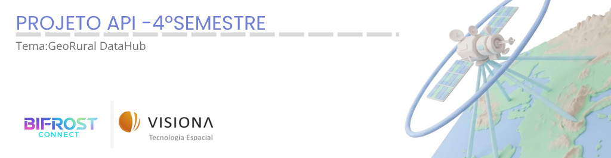
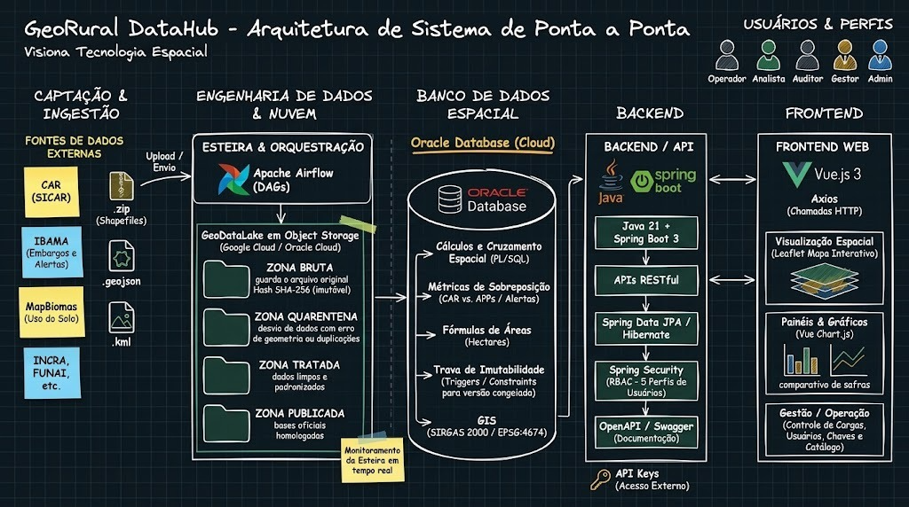

<a name="topo"></a>
<h1 align="center">API 4º Semestre - GeoRural DataHub (Visiona Tecnologia Espacial)</h1>

<div align="center">
  
</div>

---

<div align="center">

<a href="#desafio">🎯 Desafio</a> | 
<a href="#objetivo">✅ Objetivo</a> | 
<a href="#product-backlog">📖 Backlog do Produto</a> | 
<a href="#detalhamento-stories">🏃 Detalhamento das User Stories (DoR)</a> | 
<a href="#evidencias-dod">🟢 Evidências de Conclusão (DoD)</a> | 
<a href="#tecnologias">💻 Tecnologias</a> | 
<a href="#sprints">📌 Cronograma de Sprints</a> | 
<a href="#manual-instalacao">📘 Manual de Instalação</a> | 
<a href="#manual-do-usuario">📘 Manual do Usuário</a> | 
<a href="#membros">👥 Membros</a>

</div>

<br>

<table>
  <tr>
    <td><strong>Status do Projeto:</strong></td>
    <td>🟢 Concluído</td>
  </tr>
  <tr>
    <td><strong>MVP</strong></td>
    <td> <a href="https://youtu.be/YIhigo3PZdg" target="_blank">
         </a> 
    </td>
</table>

<br>

<h2 id="desafio">🎯 Desafio Proposto</h2>
<p>
A <strong>Visiona Tecnologia Espacial</strong> trabalha com dados territoriais e de satélite para apoiar fiscalizações ambientais e análise de conformidade em crédito rural. No dia a dia, os dados de imóveis rurais (CAR), Reservas Legais (RL), APPs e alertas de desmatamento chegam de várias fontes (como IBAMA, MapBiomas e INCRA). O problema é que essas bases vêm sem padrão nenhum, com geometrias sobrepostas, cadastros duplicados e mudanças constantes. Sem um controle centralizado, fica impossível responder: <em>qual arquivo foi usado no cálculo, o que foi barrado por inconsistência e como recalcular ou auditar um resultado antigo</em>.
</p>

<br>

<h2 id="objetivo">✅ Objetivo da Solução</h2>
<p>
Desenvolver o <strong>GeoRural DataHub</strong>, uma plataforma de dados espaciais dividida em quatro camadas (Zona Bruta, Quarentena, Tratada e Publicada). O sistema automatiza a entrada de dados com checagem de erros, separa os registros com falha antes do processamento, roda os cruzamentos territoriais no banco e gera versões oficiais fechadas dos indicadores ambientais para garantir que qualquer análise possa ser auditada e reproduzida no futuro.
</p>

<br>

<h2 id="product-backlog">📖 Backlog do Produto</h2>

<table>
  <thead>
    <tr>
      <th>Rank</th>
      <th>Prioridade</th>
      <th>User Story</th>
      <th>Estimativa (SP)</th>
      <th>Sprint</th>
    </tr>
  </thead>
  <tbody>
    <!-- SPRINT 1 -->
    <tr>
      <td>1</td>
      <td>Alta</td>
      <td>Como <strong>operador de dados</strong>, quero <strong>cadastrar os dados de origem de uma base (órgão emissor, ano e sistema de coordenadas)</strong> para organizar a procedência dos arquivos e saber exatamente qual safra está entrando no sistema.</td>
      <td>5</td>
      <td>1</td>
    </tr>
    <tr>
      <td>2</td>
      <td>Alta</td>
      <td>Como <strong>operador de dados</strong>, quero <strong>fazer upload salvando uma cópia original com hash SHA-256 na Zona Bruta</strong> para garantir que o arquivo enviado não foi alterado ou corrompido durante a ingestão.</td>
      <td>8</td>
      <td>1</td>
    </tr>
    <tr>
      <td>3</td>
      <td>Alta</td>
      <td>Como <strong>operador de dados</strong>, quero <strong>ver o andamento das etapas da carga na tela</strong> para saber rapidamente em qual passo o processamento está e onde deu erro se a execução falhar.</td>
      <td>8</td>
      <td>1</td>
    </tr>
    <tr>
      <td>4</td>
      <td>Alta</td>
      <td>Como <strong>operador de dados</strong>, quero <strong>um filtro que desvie registros inconsistentes para quarentena</strong> para barrar geometrias quebradas ou dados duplicados antes que eles cheguem na base tratada.</td>
      <td>8</td>
      <td>1</td>
    </tr>
    <!-- SPRINT 2 -->
    <tr>
      <td>5</td>
      <td>Alta</td>
      <td>Como <strong>auditor ambiental</strong>, quero <strong>rastrear a linhagem de um indicador até o arquivo bruto de entrada</strong> para comprovar para auditorias quais bases e versões serviram de insumo pro cálculo.</td>
      <td>13</td>
      <td>2</td>
    </tr>
    <tr>
      <td>6</td>
      <td>Alta</td>
      <td>Como <strong>analista territorial</strong>, quero <strong>calcular no sistema a área de sobreposição entre polígonos do CAR e alertas ambientais</strong> para não depender de cálculos manuais demorados na emissão de laudos.</td>
      <td>13</td>
      <td>2</td>
    </tr>
    <tr>
      <td>7</td>
      <td>Alta</td>
      <td>Como <strong>gestor de dados</strong>, quero <strong>travar versões homologadas de indicadores impedindo qualquer alteração</strong> para não correr o risco de atualizações novas apagarem análises feitas no passado.</td>
      <td>8</td>
      <td>2</td>
    </tr>
    <tr>
      <td>8</td>
      <td>Média</td>
      <td>Como <strong>analista territorial</strong>, quero <strong>visualizar os polígonos e sobreposições em um mapa interativo</strong> para conferir as irregularidades em tela sem precisar abrir softwares pesados de GIS no computador.</td>
      <td>8</td>
      <td>2</td>
    </tr>
    <!-- SPRINT 3 -->
    <tr>
      <td>9</td>
      <td>Média</td>
      <td>Como <strong>analista de dados</strong>, quero <strong>um catálogo com todas as bases carregadas e o status de cada uma</strong> para achar rápido quais dados estão prontos e disponíveis para consulta.</td>
      <td>5</td>
      <td>2</td>
    </tr>
    <tr>
      <td>10</td>
      <td>Média</td>
      <td>Como <strong>analista territorial</strong>, quero <strong>comparar duas safras de uma mesma região lado a lado</strong> para avaliar visualmente como as áreas de desmatamento ou alertas mudaram ao longo do tempo.</td>
      <td>8</td>
      <td>3</td>
    </tr>
    <tr>
      <td>11</td>
      <td>Média</td>
      <td>Como <strong>gestor ambiental</strong>, quero <strong>exportar os resultados em tabelas CSV ou GeoJSON</strong> para compartilhar as métricas com áreas parceiras e gerar relatórios externos.</td>
      <td>5</td>
      <td>3</td>
    </tr>
    <tr>
      <td>12</td>
      <td>Baixa</td>
      <td>Como <strong>integrador externo</strong>, quero <strong>gerar chaves de API com opção de revogação</strong> para integrar outros sistemas com segurança sem ter que passar senha de login.</td>
      <td>5</td>
      <td>3</td>
    </tr>
    <tr>
      <td>13</td>
      <td>Baixa</td>
      <td>Como <strong>administrador</strong>, quero <strong>gerenciar perfis e permissões dos usuários</strong> para que cada membro do time acerte apenas nas funções que competem ao seu papel no projeto.</td>
      <td>3</td>
      <td>3</td>
    </tr>
  </tbody>
</table>

<br>

<h2 id="detalhamento-stories">🏃 Detalhamento das User Stories (DoR)</h2>
<table>
  <thead>
    <tr>
      <th>Conteúdo Disponível</th>
      <th>Link de Acesso</th>
    </tr>
  </thead>
  <tbody>
    <tr>
      <td>Regras de negócio, especificação das 4 zonas do DataLake, wireframes e critérios de prontidão.</td>
      <td><a href="docs\processo\DoR\DoR Backlog do Produto">🔍 Acessar Detalhamento (DoR)</a></td>
    </tr>
  </tbody>
</table>

<br>

<h2 id="evidencias-dod">🟢 Evidências de Conclusão (DoD)</h2>
<table>
  <thead>
    <tr>
      <th>Garantia de Qualidade</th>
      <th>Relatório Completo</th>
    </tr>
  </thead>
  <tbody>
    <tr>
      <td>Testes unitários e de integração, scripts PL/SQL validados, DAGs homologadas e documentação OpenAPI.</td>
      <td><a href="docs\processo\DoD\DoD Backlog do Produto">📊 Visualizar Evidências (DoD)</a></td>
    </tr>
  </tbody>
</table>

<br>

<h2 id="tecnologias">💻 Tecnologias e Ferramentas</h2>


<br>

<h2 id="sprints">📌 Cronograma de Sprints (Épicos)</h2>

<table>
  <thead>
    <tr>
      <th>Sprint</th>
      <th>Épico / Foco de Entrega</th>
      <th>Principais Entregas</th>
      <th>Documentação</th>
    </tr>
  </thead>
  <tbody>
    <tr>
      <td><strong>Sprint 1</strong></td>
      <td>Épico 1: Ingestão, Quarentena e Orquestração do Fluxo</td>
      <td>Cadastro de Datasets/Fontes, Upload na Zona Bruta com Hash SHA-256, Motor de Validação com Desvio para Quarentena e Monitoramento de DAGs no Airflow.</td>
      <td><a href="./docs/processo/sprints/Sprint 1">📂 Ver Sprint 1</a></td>
    </tr>
    <tr>
      <td><strong>Sprint 2</strong></td>
      <td>Épico 2: Análise Espacial, Rastreabilidade e Versionamento</td>
      <td>Linhagem do Indicador ponta a ponta, Cruzamento Territorial (CAR vs. Alertas/APPs), Fechamento de Versões Imutáveis e Mapa Interativo com Leaflet.</td>
      <td><a href="./docs/processo/sprints/Sprint 2">📂 Ver Sprint 2</a></td>
    </tr>
    <tr>
      <td><strong>Sprint 3</strong></td>
      <td>Épico 3: Inteligência, Portabilidade e Governança</td>
      <td>Catálogo Completo de Datasets, Comparação Temporal entre Versões (Chart.js), Exportação Estruturada (CSV/GeoJSON), API Keys e Gestão de Perfis de Usuários.</td>
      <td><a href="./docs/processo/sprints/Sprint 3">📂 Ver Sprint 3</a></td>
    </tr>
  </tbody>
</table>

<br>

<h2 id="manual-instalacao">📘 Manual de Instalação e Execução</h2>
🔗 <strong><a href="./docs/executavel">Acessar os executaveis</a></strong>

Este diretório contém o executável autossuficiente (standalone) do Frontend do GeodataHub para Linux.

## Características
- **100% Autossuficiente**: Todos os arquivos do frontend (HTML, JS, CSS, imagens) estão embutidos no binário. Não necessita de Node.js, npm, nginx ou arquivos externos para rodar.
- **Suporte a .env em Tempo de Execução**: Lê automaticamente as variáveis de ambiente do arquivo `.env` sem precisar recompilar a aplicação.
- **Roteamento SPA Completo**: Suporta o HTML5 History Mode do Vue Router (todas as rotas carregam normalmente sem erro 404).

---

## Como Usar

### 1. Configurar o arquivo .env
Edite ou crie o arquivo `.env` na mesma pasta do executável:

```env
PORT=3000
HOST=0.0.0.0
VITE_API_BASE_URL=http://localhost:8080